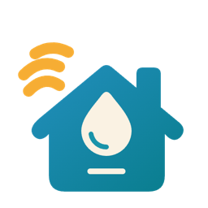

# Wassermanager

Eigenes Home-Assistant-Panel mit einer Vorschau in `preview.html`. Die Vorschau
lässt sich direkt im Browser öffnen und verwendet Demodaten.

## Installation in Home Assistant

Voraussetzung ist Home Assistant 2026.3 oder neuer.

1. Öffne **HACS → ⋮ → Benutzerdefinierte Repositories** und füge
   `https://github.com/gwmpvv5948-dot/wassermanager` in der Kategorie
   **Integration** hinzu.
2. Lade **Wassermanager** in HACS herunter und starte Home Assistant neu.
3. Öffne **Einstellungen → Geräte & Dienste → Integration hinzufügen →
   Wassermanager** und wähle den Sensor für den kumulierten Zählerstand.
4. Öffne **Wassermanager** in der Seitenleiste und trage den Ablesewert
   vom 1. Januar in m³ ein.

Wenn du die vorherige Version über `panel_custom` eingerichtet hast,
entferne deren Wassermanager-Eintrag aus `configuration.yaml` vor dem
Neustart, damit die Integration den Pfad `wassermanager` registrieren kann.

## Berechnung

- **Heute** verwendet den letzten gültigen Zählerstand des Tages minus
  der ersten gültigen Ablesung desselben Tages.
- **Täglicher Verbrauch** zeigt die Differenz zwischen den letzten
  Ablesungen zweier aufeinanderfolgender Kalendertage in Litern. Grundlage
  sind für frühere Tage die verfügbaren Recorder-Daten und die Zeitzone von Home Assistant.
  Der heutige Balken verwendet denselben Wert wie **Heute**. Fehlende Tage
  oder fallende Zählerstände erscheinen als Lücken. Der
  Verlauf wird beim Öffnen und während der Anzeige regelmäßig geladen.
- **Seit 1. Januar** verwendet den aktuellen Zählerstand minus dem
  eingetragenen Ablesewert in m³. In Home Assistant speichert die
  Number-Entität **Wassermanager Ablesewert 1. Januar** den Wert für das
  laufende Kalenderjahr und stellt ihn nach einem Neustart wieder her.
  Bei Jahreswechsel muss der neue Ablesewert eingetragen werden.
  Frühere Browserwerte können einmalig im Panel neu eingetragen werden.
  Die Vorschau verwendet weiterhin den Browserspeicher. Verwende bei einem
  Zählertausch einen durchgängigen kumulierten Sensor.

Die Liveansicht verwendet die bestehende Home-Assistant-Sitzung für die
History-API. Es werden keine Zugangsdaten im Projekt hinterlegt.
